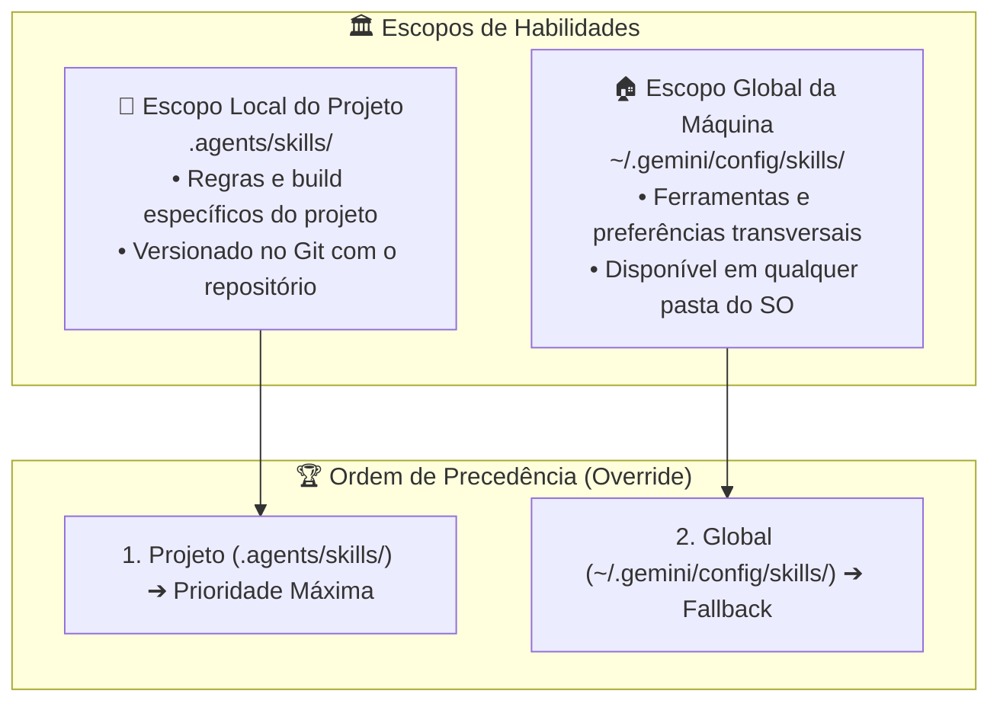
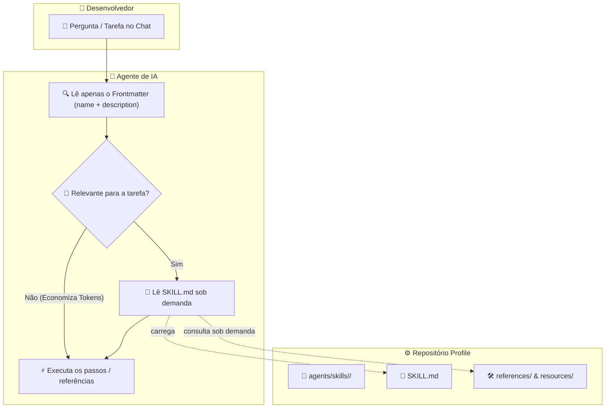

# 🧠 Portable AI Agents (Habilidades & Regras Globais para IA)

> Hub central de habilidades portáteis, procedimentos, regras cognitivas e runbooks para agentes de inteligência artificial (Google Antigravity / Gemini, OpenAI / ChatGPT, Claude e assistentes autônomos de código).

---

### 🤖 Compatibilidade de Agentes & Modelos


-orange?logo=yaml&logoColor=white>)

---

## 🎯 Arquitetura de IA no Profile (`agents/`)

No ecossistema do **Quarteto de Produtividade**, o diretório **`agents/`** centraliza a inteligência e os guardrails cognitivos universais da estação de trabalho:

1. **`rules/` (4 Regras Globais da Estação):** Guardrails cognitivos transversais aplicados a todas as sessões e repositórios.
2. **`skills/` (19 Skills Atemporais sob Demanda):** Runbooks cognitivos e fluxos de engenharia carregados sob demanda via progressive disclosure.

| Camada                                                                                                         | Papel Central                           | Tipo de Conteúdo                                                                    | Destinatário / Consumidor                                                                   |
| :------------------------------------------------------------------------------------------------------------- | :-------------------------------------- | :---------------------------------------------------------------------------------- | :------------------------------------------------------------------------------------------ |
| **[Setup](https://github.com/GabrielFrigo4/setup)**                                                            | **O "COMO" (Provisionamento Ativo)**    | Receitas atômicas de automação e scripts de sistema (`.sh`, `.cmd`, `.ps1`).        | **Sistema Operacional** (com privilégios de administrador / root).                          |
| **[`editors/`](../editors/README.md), [`terminals/`](../terminals/README.md), [`tools/`](../tools/README.md)** | **O "O QUÊ" (Estado Declarativo)**      | Arquivos estáticos puros (`.json`, `.toml`, `.yaml`, `.el`, `.vim`, `.profile`).    | **Usuário & Aplicações** (espaço do `$HOME`, zero sudo).                                    |
| **`agents/`** _(esta pasta)_                                                                                   | **Inteligência de IA (Rules & Skills)** | Regras globais (`rules/`) e pacotes modulares de procedimentos guiados (`skills/`). | **Agentes de IA** (Antigravity, Gemini, OpenAI, Claude) para execução assistida e autônoma. |
| **[`.scripts/audit/`](../.scripts/audit/README.md)**                                                           | **Auditoria & Quality Gates**           | Validação estática de integridade, links e formatos.                                | **Desenvolvedor** (execução pontual em linha de comando).                                   |
| **[`docs/`](../docs/README.md)**                                                                               | **Documentação Humana**                 | Arquitetura, manuais de SO e guias técnicos.                                        | **Desenvolvedor** (leitura técnica e arquitetural).                                         |

---

## 🎯 Regras Globais da Estação (4 Rules em `rules/`)

| Regra                                                              | Finalidade                                                                                                                                              | Escopo / Aplicação                           |
| :----------------------------------------------------------------- | :------------------------------------------------------------------------------------------------------------------------------------------------------ | :------------------------------------------- |
| [`tone-and-economy.md`](./rules/tone-and-economy.md)               | Tom técnico sóbrio, densidade de sinal por token, matriz real de shells (`zsh`, `bash`, FreeBSD `sh`, OpenBSD `ksh`) e escapes `$'\e'`.                 | Universal em todas as sessões (`always_on`). |
| [`clarification-protocol.md`](./rules/clarification-protocol.md)   | Protocolo bidirecional de alinhamento proativo (`Master <-> User` e `Worker <-> Master` com template compacto `[CLARIFICATION REQUEST]`).               | Universal em todas as sessões (`always_on`). |
| [`open-source-sovereignty.md`](./rules/open-source-sovereignty.md) | Invariante de isolamento soberano para forks e projetos de terceiros em `**/Open Source/**` (e legados `**/OSS/**`).                                    | Universal em todas as sessões (`always_on`). |
| [`agentic-orchestration.md`](./rules/agentic-orchestration.md)     | Governança de orquestração multi-agente (`multi-agent-orchestration`), política de herança dinâmica (`Model: 'inherit'`) e bloqueio `swarm`/`schedule`. | Universal em todas as sessões (`always_on`). |

---

## 📚 Catálogo Canônico de Skills Portáteis (19 Runbooks Atemporais em `skills/`)

| Categoria                     | Skill                                                                          | Descrição e Escopo de Ativação                                                                                                               |
| :---------------------------- | :----------------------------------------------------------------------------- | :------------------------------------------------------------------------------------------------------------------------------------------- |
| **Governança Agentic & Repo** | [`agentic-repo-governance`](./skills/agentic-repo-governance/SKILL.md)         | Tríade `AGENTS.md`/`rules`/`skills`, 2 tiers, curadoria C.A.R.P., hermetismo `rm -rf .agents` e scaffold de repositórios multi-stack.        |
| **Engenharia Antifrágil**     | [`antifragile-engineering`](./skills/antifragile-engineering/SKILL.md)         | Auto-cura em voo, cascata ativa XDG/FHS, zero falhas cegas e padrões multi-shell (POSIX `sh`, NuShell, PowerShell).                          |
| **C Moderno & POSIX**         | [`c-engineering`](./skills/c-engineering/SKILL.md)                             | C23 (`nullptr`, `constexpr`, `<stdckdint.h>`, `[[nodiscard]]`), sanitizers, POSIX.1-2024, `kqueue`/`epoll`/`poll` e pthreads.                |
| **Refatoração & Qualidade**   | [`clean-code-refactor`](./skills/clean-code-refactor/SKILL.md)                 | Auditoria POSIX, taxonomia tripartite de comentários, refatoração Clean-Break sem legado e custódia proativa Boy Scout Rule.                 |
| **C++23 & RAII de Sistemas**  | [`cpp-engineering`](./skills/cpp-engineering/SKILL.md)                         | C++23 (`std::expected`, `<print>`, concepts, ranges), wrappers RAII (`UniqueFd`, `MMapRegion`), `kqueue`/`epoll` e `std::jthread`.           |
| **Sistemas Multiplataforma**  | [`crossplatform-systems`](./skills/crossplatform-systems/SKILL.md)             | Portabilidade FreeBSD, Linux, macOS, OpenBSD, illumos e MSYS2, init neutrality, PTY em CI (`script -q /dev/null`) e TTYs de kernel.          |
| **GNU Emacs & Elisp**         | [`emacs-engineering`](./skills/emacs-engineering/SKILL.md)                     | GNU Emacs moderno e Elisp lexicalmente vinculado, PGTK Wayland, `libgccjit`, Tree-sitter nativo, Elpaca assíncrono, Eglot LSP e batch tests. |
| **Engenharia de Testes**      | [`ironclad-testing`](./skills/ironclad-testing/SKILL.md)                       | Testes adversariais (Advogado do Diabo), 5 barreiras de contenção, sanitizers e harnesses em C23, C++23, POSIX `sh`, Go e Python.            |
| **Editoração Científica**     | [`latex-typesetting`](./skills/latex-typesetting/SKILL.md)                     | Compilação isolada `-outdir=build`, Makefiles POSIX silenciosos, listagens sincronizadas e redação acadêmica direta.                         |
| **Orquestração Multi-Agente** | [`multi-agent-orchestration`](./skills/multi-agent-orchestration/SKILL.md)     | Coordenação Master-Worker (`Model: 'inherit'`), pool 2–8, tecelagem ABI, verificação Red/Blue-Team e torneios em worktrees.                  |
| **Makefiles Universais**      | [`posix-makefile-architect`](./skills/posix-makefile-architect/SKILL.md)       | Makefiles silenciosos `.POSIX: .SILENT:` portáteis entre `bmake`, `gmake`, `pdpmake` e BusyBox com subshells `(cd dir && $(MAKE))`.          |
| **Padrões de Shell POSIX**    | [`posix-shell-standards`](./skills/posix-shell-standards/SKILL.md)             | Baseline FreeBSD `sh`, eliminação de bashismos, escapes ANSI `$'\e'`/`\x1b` e práticas defensivas de runtime.                                |
| **Investigação Primária**     | [`primary-source-research`](./skills/primary-source-research/SKILL.md)         | Diagnóstico de causa raiz e checagem ativa de versões contra código-fonte upstream, especificações formais, manpages e release notes.        |
| **Infraestrutura Soberana**   | [`sovereign-infrastructure`](./skills/sovereign-infrastructure/SKILL.md)       | Cloud-Exit e bare-metal em FreeBSD, Linux, illumos e OpenBSD, além do padrão Single-Binary Embedded Web.                                     |
| **Redação & Design Técnico**  | [`technical-writing-standards`](./skills/technical-writing-standards/SKILL.md) | Redação técnica Reader-First, READMEs com Shields.io, diagramação Mermaid e formatação Prettier.                                             |
| **Tipografia & TTY**          | [`terminal-typography-tty`](./skills/terminal-typography-tty/SKILL.md)         | Nerd Fonts, `wcwidth`, delimitadores de largura zero, máscara XOR `0xee` (`0xee10`), DECSCUSR e mouse GPM/`moused`.                          |
| **Filosofia UNIX**            | [`unix-philosophy-auditor`](./skills/unix-philosophy-auditor/SKILL.md)         | Auditoria estática e comportamental contra os 22 Princípios de Engenharia UNIX e Soberania.                                                  |
| **VCS & CI/CD**               | [`vcs-and-ci-governance`](./skills/vcs-and-ci-governance/SKILL.md)             | Coexistência Git + Game of Trees (`got`/`tog`), Conventional Commits, hooks self-healing (`.githooks`) e CI multiplataforma.                 |
| **Governança XDG & Dotfiles** | [`xdg-dotfiles-governance`](./skills/xdg-dotfiles-governance/SKILL.md)         | Segregação XDG Base Directory, precedência Local > Global, auditoria POSIX de symlinks, JSON/JSONC/YAML/TOML e permissões octais.            |

---

## 🌐 Escopos de Atuação: Global (Home) vs. Local (Projeto)

Os agentes modernos suportam dois níveis de alcance para as skills:



Se existir uma skill com o mesmo nome na Home global e no projeto local:

$$\text{Skill do Projeto (.agents/skills/)} \quad \mathbf{> \text{ (sobrescreve)}} \quad \text{Skill Global da Home (~/.gemini/config/skills/)}$$

---

## 🔄 Fluxo de Descoberta & Progressive Disclosure

Para preservar a janela de contexto dos modelos, as skills operam em **Progressive Disclosure**:



---

## 🏗️ Anatomia Canônica de uma Skill Portátil

```text
agents/skills/<nome_da_skill>/
├── SKILL.md          # [OBRIGATÓRIO] Frontmatter YAML + workflow (17 a 128 linhas)
├── scripts/          # [OPCIONAL] Scripts auxiliares determinísticos
├── references/       # [OPCIONAL] Manuais densos lidos sob demanda
├── examples/         # [OPCIONAL] Exemplos práticos de código
└── resources/        # [OPCIONAL] Templates ou schemas
```

---

## 🚀 Instalação & Consumo

### 1. Instalação Dinâmica via Symlink (`profile.sh sync`)

O `profile.sh sync` vincula `agents/skills` e `agents/rules` automaticamente em `~/.gemini/config/`:

```sh
mkdir -p "${HOME}/.gemini/config"
ln -sfn "${HOME}/.local/share/profile/agents/skills" "${HOME}/.gemini/config/skills"
ln -sfn "${HOME}/.local/share/profile/agents/rules" "${HOME}/.gemini/config/rules"
```

### 2. Instalação Pontual em Projeto Local

```sh
mkdir -p .agents/skills
cp -r "${HOME}/.local/share/profile/agents/skills/minha-skill" .agents/skills/
```

---

## 📜 Princípios e Padrões da Camada de Skills

Conforme estabelecido em [`../PRINCIPLES.md`](../PRINCIPLES.md):

1. **Progressive Disclosure:** Mantenha `SKILL.md` no sweet spot de **17 a 128 linhas**, movendo tabelas densas e exemplos longos para `references/`.
2. **Permissões Canônicas em 4 Dígitos:** Documentos (`.md`, `.yaml`, `.json`) utilizam `chmod 0644`; scripts executáveis utilizam `chmod 0755`.
3. **Ativações Determinísticas:** Valide estado antes e depois de cada alteração.
4. **Invariante do Hermetismo (`rm -rf .agents`):** Código de produção nunca consome ou depende de skills de IA.
