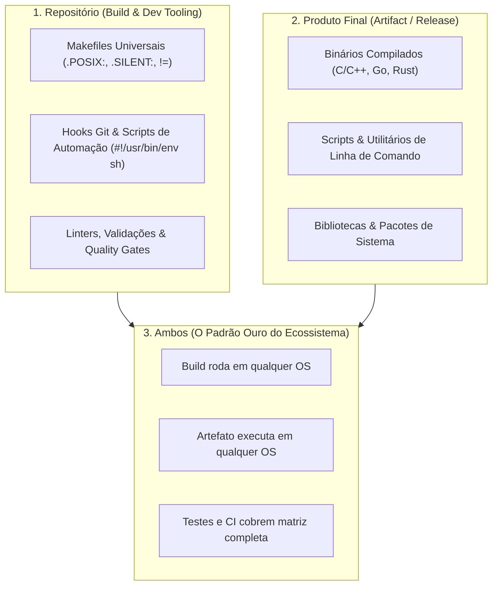

# 🌐 System Cross-Platforms & Operational Diagnostics

Esta habilidade orienta o agente no design, automação, portabilidade multiplataforma e diagnóstico profundo de saúde de estações de trabalho e ambientes de produção UNIX/POSIX.

---

## 🧭 As Três Dimensões da Portabilidade



1. **Repositório Multiplataforma (Build & Dev Tooling):** Makefiles, githooks e scripts de setup operam de forma transparente em qualquer sistema suportado sem utilitários proprietários.
2. **Produto Final Multiplataforma (Artifact / Release):** O artefato (binário executável, biblioteca ou script) executa com estabilidade nos sistemas de destino.
3. **Ambos Multiplataforma (O Padrão Ouro do Ecossistema):** Compilação e execução são estritamente universais e agnósticas de plataforma.

---

## 🏛️ Matriz de Paridade Multiplataforma

### 🔴 1. FreeBSD (14/15/16 CURRENT, STABLE & RELEASE)

- Kernel e userland formam base coesa. Padrão ouro de aderência POSIX e régua máxima de portabilidade.
- Multiplexação de eventos escalável via `kqueue(2)` / `kevent(2)`.
- Gerenciamento de serviços via `rc.d` e `sysrc`, console em `vt(4)` e empacotamento nativo com `pkg`.
- Referências aprofundadas: [`references/freebsd-architecture.md`](./references/freebsd-architecture.md).

### 🐧 2. Linux (Neutralidade de Init: Systemd, SysVinit, OpenRC & runit)

- Multiplexação de E/S via `epoll(7)` e subsistema de eventos via `io_uring`.
- Neutralidade de PID 1: suporte harmonioso a **Debian com Systemd** e sistemas **Não-Systemd** (Devuan/SysVinit, Alpine/Gentoo/OpenRC, Void/runit).
- Regras de hardware via `udev`/`eudev` em `/etc/udev/rules.d/` para independência de init. Cuidado com _usrmerge_ e GNUismos ausentes nos BSDs.

### 🍎 3. macOS (Darwin / Mach / BSD Userland)

- Apple Clang como toolchain padrão; `zsh` como shell interativo.
- Userland BSD clássica (`sed`, `grep`, `tar` sem flags GNU). Suporte a `kqueue(2)`.
- Resolução de prefixos: Homebrew Apple Silicon (`/opt/homebrew`), Intel (`/usr/local`), MacPorts (`/opt/local`).

### 🪟 4. Windows & MSYS2

- Subsistema MSYS2 com toolchain moderna `UCRT64` (biblioteca de runtime C universal).
- Finais de linha estritamente UNIX (`LF`) via `.gitattributes`. Automação híbrida em PowerShell (`.ps1`) e shell POSIX (`sh.exe`).

### 🐡 5. OpenBSD (Segurança Pragmática & Minimalismo)

- Mitigações de kernel: `pledge(2)` e `unveil(2)`. Filtragem de pacotes com `pf(4)`.
- Shell padrão `/bin/ksh` (PD-KSH): captura de escapes via `printf '\x1b'` e demarcação `\x01` no `PS1`. Elevação estrita via `doas`.

### ☀️ 6. illumos & NetBSD (Solaris Herança & Portabilidade Extrema)

- **illumos (SmartOS/OmniOS):** Event ports (`port_create(3C)`), Solaris Zones nativas/`lx-brand`, Crossbow VNICs e DTrace.
- **NetBSD:** Berço da `libedit` e ecossistema `pkgsrc` multiplataforma universal.

---

## 🚦 TTY & CI Headless: Padrão PTY (`script -q /dev/null`)

Em runners headless de CI/CD (GitHub Actions, SSH sem PTY), shells interativos acionam `tcsetpgrp()`. Enquanto no Linux a syscall retorna erro ignorável, no kernel FreeBSD dispara `SIGTTIN` (sinal 21), congelando o processo em `SIGSTOP`.

- **Alocação de Pseudo-Terminal Defensiva:**
    ```sh
    script -q /dev/null bash -i -c 'echo "Prompt OK: ${PS1}"'
    ```
- Para drivers TTY e CI traps, consulte [`references/tty-ci-traps.md`](./references/tty-ci-traps.md).
- Para consoles virtuais e framebuffer, consulte [`references/virtual-consoles-tty.md`](./references/virtual-consoles-tty.md).

---

## 🩺 Diagnóstico de Saúde Operacional de Sistemas

### 1. Sessão Gráfica & Protocolo de Janelas

Inspecione se o ambiente opera sob Wayland nativo ou fallback X11:

```sh
echo "Sessão: ${XDG_SESSION_TYPE:-desconhecido}"
echo "Wayland Display: ${WAYLAND_DISPLAY:-nenhum}"
```

### 2. Aceleração Gráfica por Hardware (VA-API & Vulkan)

Valide a presença de aceleração de vídeo por hardware e nós de renderização DRM:

```sh
if command -v vainfo > "/dev/null" 2>&1; then
    vainfo
elif [ -e "/dev/dri/renderD128" ]; then
    echo "Dispositivo de renderização /dev/dri/renderD128 ativo."
fi
```

### 3. Subsistema Multimídia PipeWire

Confirme o daemon PipeWire e a camada de emulação PulseAudio:

```sh
if command -v pactl > "/dev/null" 2>&1; then
    pactl info | grep -E "Server Name|Server Version"
fi
```

### 4. Multiplexação de E/S & Recursos de Kernel

Audite a capacidade de I/O escalável e limites de descritores de arquivo:

```sh
echo "Limite de descritores abertos: $(ulimit -n)"
if [ "$(uname -s)" = "FreeBSD" ] || [ "$(uname -s)" = "Darwin" ]; then
    echo "Multiplexador de eventos primário: kqueue(2)"
elif [ "$(uname -s)" = "Linux" ]; then
    echo "Multiplexador de eventos primário: epoll(7)"
fi
```

### 5. Memória, Cargas e Anomalias de Processos

Diagnóstico defensivo sem privilégios administrativos:

```sh
vmstat 1 2 2> "/dev/null" || sar 1 2 2> "/dev/null" || uptime
```

### 6. Conectividade & Interfaces de Rede

Verifique o estado de interfaces ativas e conectividade local:

```sh
ip -brief address 2> "/dev/null" || ifconfig -a 2> "/dev/null" || netstat -in
```

---

## 🛠️ Regras Canônicas Multiplataforma

1. **Shebang Universal:** Invariavelmente `#!/usr/bin/env sh` para shell scripts e `#!/usr/bin/env python3` para Python.
2. **Makefiles Universais:** Cabeçalho `.POSIX: .SILENT:`, `MAKEFLAGS += --no-print-directory -s`, `CC ?= cc`, flags neutras e comandos com `!=`.
3. **Zero-Sudo e Zero-Bypass:** Diagnósticos e utilitários operam no espaço de usuário (`$HOME`), degradando graciosamente sem privilégios.
4. **Permissões Canônicas Octais:** `0755` para executáveis, `0644` para arquivos regulares e `0700`/`0600` para segredos.
5. **Redirecionamento Seguro:** Envolva destinos de redirecionamento em aspas duplas (ex: `> "/dev/null" 2>&1`).

---

## 🔗 Links Oficiais de Referência

- **The FreeBSD Project:** <https://www.freebsd.org/> | Releases: <https://www.freebsd.org/releases/>
- **Wayland Protocol Architecture:** <https://wayland.freedesktop.org/>
- **PipeWire Multimedia Daemon:** <https://pipewire.org/>
- **Mesa 3D Graphics & Video Acceleration (VA-API):** <https://www.mesa3d.org/>
- **OpenBSD Project & PF FAQ:** <https://www.openbsd.org/> | <https://www.openbsd.org/faq/pf/>
- **illumos Project Docs:** <https://illumos.org/docs/>
- **The Open Group (POSIX):** <https://www.opengroup.org/>
